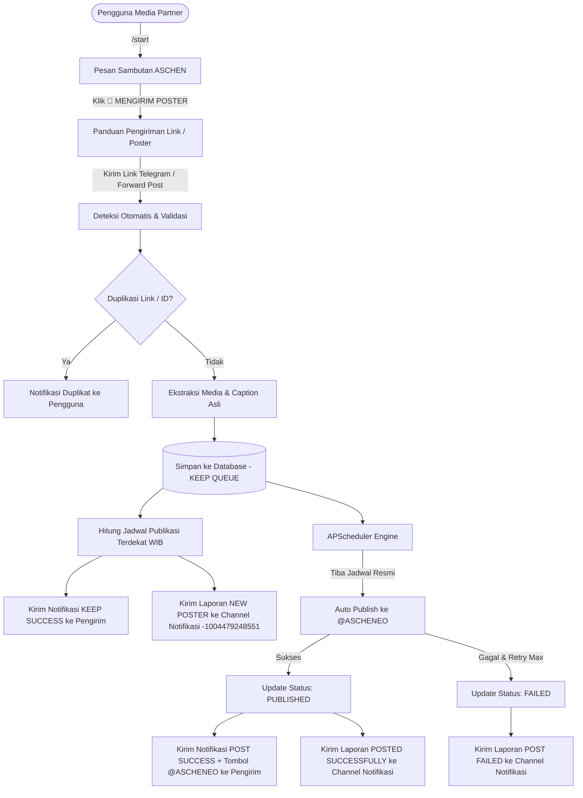

# 𓄲 MEDIAPATNER BOT — ASCHEN EVENT ORGANIZER
### Automatic Media Partner Poster Management System

> **Elegant Collaboration, Memorable Celebration.**

Sistem Telegram Bot otomatis dan profesional untuk menerima, memproses, memvalidasi, menyimpan, menjadwalkan, dan menyebarkan poster Media Partner ke Channel Utama **@ASCHENEO** secara otonom tanpa memerlukan intervensi manual dari Admin.

---

## 📌 Identitas & Konfigurasi Bot

- **Nama Bot:** MEDIAPATNER
- **Organisasi:** ASCHEN EVENT ORGANIZER
- **Fungsi:** Automatic Media Partner Poster Management
- **Channel Penyebaran Poster:** [@ASCHENEO](https://t.me/ASCHENEO)
- **Link Channel Utama:** `https://t.me/ASCHENEO`
- **Channel Notifikasi ID:** `-1004479248551`
- **Status Channel Notifikasi:** **PERMANENT** (Terkunci permanen di sistem, tidak dapat diubah)
- **Zona Waktu:** `Asia/Jakarta` (WIB / UTC+7)

---

## 🚀 Alur Kerja Sistem (Workflow)



---

## 🗓 Jadwal Publikasi Resmi ASCHEN (WIB)

Sistem menggunakan zona waktu **Asia/Jakarta (WIB)** dengan jadwal rilis poster:

| Hari | Jam Publikasi | Keterangan |
| :--- | :---: | :--- |
| **Selasa** | **09.00 WIB** | Sesi Pagi |
| **Rabu** | **12.00 WIB** | Sesi Siang |
| **Kamis** | **09.00 WIB** | Sesi Pagi |
| **Jumat** | **12.00 WIB** | Sesi Siang |
| **Sabtu** | **20.00 WIB** | Sesi Malam |
| **Minggu & Senin** | *Tidak ada* | Antrean dialihkan otomatis ke Selasa 09.00 WIB |

### Logika Penentuan Slot Terdekat (Keep Queue)
- **Sebelum jam publikasi:** Masuk ke slot di hari yang sama.
- **Tepat pada jam publikasi:** Masuk ke slot tersebut jika proses masih memungkinkan.
- **Setelah jam publikasi:** Masuk ke slot berikutnya.
- **Poster berurutan:** Jika terdapat beberapa poster pada satu slot waktu, sistem mempublikasikan poster secara berurutan dengan jeda aman (`POST_INTERVAL_SECONDS`) untuk mencegah limit Telegram.
- **Pemulihan Antrean (Restart Resilience):** Jika server mati atau bot restart, seluruh antrean `KEEP` dan `SCHEDULED` di database dipulihkan otomatis saat bot menyala kembali tanpa kehilangan data.

---

## 🔔 Format Notifikasi Resmi

### 1. Pesan Sambutan (/start)
```text
𓄲 WELCOME, MEDIA PARTNER! 𓈒

Hello! Selamat datang di layanan Media Partner ASCHEN EVENT ORGANIZER.

Terima kasih telah memilih ASCHEN sebagai partner kolaborasi Anda. Senang sekali bisa menjalin hubungan kerja sama bersama kalian!

Melalui bot ini, Anda dapat mengakses layanan Media Partner, mengirimkan kebutuhan publikasi, serta memperoleh informasi terkait kerja sama dengan ASCHEN.

Silakan gunakan tombol menu yang tersedia untuk melanjutkan proses. Pastikan mengikuti setiap instruksi agar pengajuan dapat diproses dengan baik.

Have a wonderful collaboration with us!

𓄲 ASCHEN EVENT ORGANIZER
Elegant Collaboration, Memorable Celebration.
```

### 2. Notifikasi Pengirim: KEEP SUCCESS (Section 7)
```text
𓄲 MEDIAPATNER — KEEP SUCCESS!

Poster kamu berhasil diterima dan disimpan oleh sistem.

➤ Status: KEEP
➤ Jadwal: [Hari]
➤ Tanggal: [Tanggal]
➤ Waktu: [Jam] WIB

Mohon menunggu jadwal publikasi.

Terima kasih telah menjadi Media Partner kami!
```

### 3. Notifikasi Pengirim: POST SUCCESS (Section 8)
```text
𓄲 MEDIAPATNER — POST SUCCESS!

Yeay! Poster kamu sudah berhasil dipublikasikan oleh sistem.

➤ Status: Successfully Posted
➤ Channel: @ASCHENEO

Silakan lihat poster kamu di Channel Utama kami!

Terima kasih telah menjadi Media Partner ASCHEN.
```
*(Dilengkapi tombol inline `[ LIHAT CHANNEL @ASCHENEO ]` menuju `https://t.me/ASCHENEO`)*

### 4. Laporan Channel Notifikasi Permanen (`-1004479248551`)

#### A. Poster Masuk
```text
𓄲 MEDIAPATNER — NEW POSTER INCOMING!

Seseorang baru saja mengirimkan poster Media Partner.

➤ Pengirim: [Nama]
➤ Username: [@username]
➤ Link Poster: [Link]
➤ Status: KEEP QUEUE
➤ Jadwal Posting: [Hari, Tanggal]
➤ Waktu Posting: [Jam] WIB

© MEDIAPATNER SYSTEM
```

#### B. Poster Berhasil
```text
𓄲 MEDIAPATNER — POSTED SUCCESSFULLY!

Poster berhasil diterbitkan ke Channel Utama.

➤ Pengirim: [Nama]
➤ Channel: @ASCHENEO
➤ Status: PUBLISHED
➤ Tanggal: [Tanggal]
➤ Waktu: [Jam] WIB
```

#### C. Poster Gagal
```text
𓄲 MEDIAPATNER — POST FAILED!

Poster gagal diproses atau dipublikasikan.

➤ Pengirim: [Nama]
➤ Link: [Link]
➤ Status: FAILED
➤ Penyebab: [Alasan Kegagalan]
```

---

## 🛠 Admin Dashboard (`/admin`)

Hanya akun Telegram yang terdaftar di `ADMIN_IDS` yang dapat membuka antarmuka dashboard:

1. **Dashboard Overview:** Statistik real-time (Total link masuk, poster diterima, KEEP, Published, Failed, Pengguna, Aktivitas hari ini).
2. **Keep Queue:** Daftar poster berstatus KEEP dengan navigasi halaman dan aksi detail.
3. **Scheduled Posters:** Daftar poster yang terjadwal.
4. **Published Posters:** Daftar poster yang sukses dipublikasikan beserta ID pesan di Channel.
5. **Failed Posters:** Daftar poster yang gagal beserta alasan kegagalan dan tombol retry.
6. **User Activity:** Log audit seluruh tindakan pengiriman dan administrasi sistem.
7. **Posting History:** Riwayat lengkap publikasi poster.
8. **Bot Settings:**
   - Toggle Auto Forward: [ AKTIF / NONAKTIF ]
   - Main Channel: `@ASCHENEO`
   - Notification Channel: `-1004479248551 (PERMANENT)` *(Terkunci permanen tanpa menu perubahan)*
   - Timezone: `Asia/Jakarta (WIB)`

### Aksi Manajemen Tiap Poster:
- **🚀 Publikasi Sekarang:** Publikasi langsung secara manual ke `@ASCHENEO`.
- **🗓 Ubah Jadwal (Reschedule):** Mengubah jadwal ke slot resmi berikutnya atau hari tertentu.
- **🗑 Hapus dari Antrean:** Menghapus poster dari antrean publikasi.
- **🔄 Coba Ulang (Retry):** Mengulang publikasi poster yang sempat berstatus FAILED.

---

## 💻 Panduan Instalasi & Menjalankan Bot

### 1. Prasyarat Sistem
- Python 3.10, 3.11, atau 3.12
- Akun Telegram Bot dari `@BotFather`
- Bot sudah diangkat sebagai **Administrator** di Channel `@ASCHENEO` (dengan hak posting pesan).
- Bot sudah dimasukkan ke Channel Notifikasi `-1004479248551` (dengan hak posting pesan).

### 2. Instalasi Dependensi
```bash
pip install -r requirements.txt
```

### 3. Konfigurasi Environment (`.env`)
Salin file `.env.mediapatner.example` atau buka file `.env`, lalu masukkan token Bot baru Anda:

```env
# Token baru dari @BotFather (Token lama yang terekspos HARUS di-revoke)
BOT_TOKEN=1234567890:ABCdefGhIJKlmNoPQRstuVWXyz

# ID Akun Telegram Admin (Dapatkan via @userinfobot)
ADMIN_IDS=123456789,987654321

# Channel Utama (Opsional, default @ASCHENEO)
CHANNEL_USERNAME=@ASCHENEO
CHANNEL_LINK=https://t.me/ASCHENEO

# Database & Pengaturan
DATABASE_PATH=data/mediapatner.db
POST_INTERVAL_SECONDS=8
RETRY_MAX_ATTEMPTS=3
```

### 4. Menjalankan Bot
```bash
python main.py
```

### 5. Menjalankan Tes Otomatis (Unit & Integration Tests)
```bash
pytest tests/ -v
```
*(Seluruh 24 pengujian mencakup kalkulator jadwal WIB, scraping link Telegram, database repository, validasi keyboard, dan proteksi duplikasi)*

---

## 🔒 Keamanan & Praktik Terbaik
- Token bot dimuat secara aman melalui `pydantic.SecretStr` dan tidak pernah ditampilkan dalam kode sumber, pesan log, maupun antarmuka dashboard.
- Dilengkapi **Rate Limiting Middleware** untuk mencegah spam pengiriman.
- Validasi link dan pencegahan duplikasi mencegah postingan ganda di channel `@ASCHENEO`.
- Channel notifikasi ID `-1004479248551` bersifat permanen dan tidak dapat diubah oleh siapapun melalui dashboard.

---

**Developed for ASCHEN EVENT ORGANIZER**  
*Elegant Collaboration, Memorable Celebration.*
